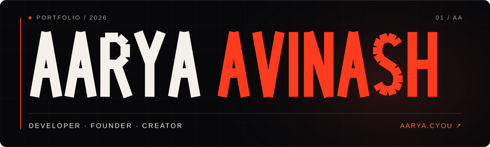

<p align="center">
  <a href="https://aarya.cyou/">
    
  </a>
</p>

<h1 align="center">Aarya Avinash</h1>

<p align="center">
  Developer · Founder of <a href="https://github.com/zyrixdevs">Zyrix Dev</a> · Creator
</p>

<p align="center">
  <a href="https://aarya.cyou/">Live portfolio</a> ·
  <a href="https://github.com/aaryaavinash">GitHub</a> ·
  <a href="https://www.instagram.com/aaryaavinash_/">Instagram</a> ·
  <a href="https://dev.zyrix.qzz.io/">Zyrix Dev</a>
</p>

---

## About this project

This is my personal space on the web. It brings together software, design, trading interests, games, and the work I am building as a student and founder of Zyrix Dev. The visual direction is cinematic and typographic, with motion that responds to scroll and respects reduced-motion preferences.

<!-- ORIGINAL (preserved, not deleted — disabled by comment): The portfolio includes selected projects, a GitHub activity view, an interactive gaming card, a music section, social profile cards, and a contact ticket. Public GitHub data is fetched live. Music uses public Last.fm scrobbles when available; the record card is a display, not an audio player. Instagram and Discord cards show confirmed profile details without invented live metrics. -->
The portfolio includes selected projects, a GitHub activity view, an interactive gaming card, a music section, social profile cards, and a contact ticket. Public GitHub data is fetched live. Music uses public Last.fm scrobbles when available; the record card is a display, not an audio player. The Discord card embeds Aarya's live public status through [Discord GitHub Preview](https://github.com/the-snesler/discord-github-readme), with a static fallback. Instagram shows confirmed profile details without invented metrics.

## Built with

| Layer | Technology |
| --- | --- |
| App | Vite, TypeScript, React islands |
| Interface | Tailwind CSS, custom CSS, Anton, Onest, Aarya Tall prototype |
| Motion | GSAP, ScrollTrigger, Lenis, Motion |
| Interactive components | React Bits and Kokonut UI adaptations |
| Hosting and data | Cloudflare Pages Functions, public GitHub and Last.fm feeds |

## Run locally

```bash
git clone https://github.com/aaryaavinash/portfolio.git
cd portfolio
npm ci
npm run dev
```

Open the URL printed by Vite. For a production build:

```bash
npm run build
npm run preview
```

The build includes TypeScript checking. Focused data checks are in `tools/check-*.mjs`; for example, `node tools/check-music.mjs`.

## Deployment and live data

The [live site](https://aarya.cyou/) runs on Cloudflare Pages from this repository's `main` branch. Use `npm run build` as the build command and `dist` as the output directory. The root `functions/api/music.ts` provides `/api/music` on Pages; a plain Vite preview falls back to the latest public Last.fm widget and cannot show the full history feed.

Spotify listening is displayed through [Last.fm's Spotify connection](https://www.last.fm/about/trackmymusic), with no Spotify secret in the frontend. The Last.fm profile must have public scrobbles before tracks can appear. <!-- ORIGINAL (preserved, not deleted — disabled by comment): The contact address `hello@aarya.cyou` is shown in the site source; Cloudflare Email Routing must be enabled before it can receive mail. -->
<!-- ORIGINAL (preserved, not deleted — disabled by comment): The planned contact address is `hello@aarya.cyou`; Cloudflare Email Routing must be enabled before it can receive mail. -->
Mail to `hello@aarya.cyou` is forwarded by Cloudflare Email Routing to Aarya’s verified inbox.

## Project map

| Path | Purpose |
| --- | --- |
| `index.html`, `src/` | Page structure, styles, motion, React islands |
| `functions/api/music.ts` | Cloudflare Pages music endpoint |
| `public/` | Favicon, banner, project artwork, fonts, share image |
| `tools/` | Focused checks and Aarya Tall font generator |
| `.codex/` | Product, design, typography, animation, and implementation notes |

The [SEO pass](./.codex/seo.md) records the crawl, metadata, and structured-data changes for the live domain.

## Licensing

The repository contains four different rights scopes. They are deliberately separate: permission to reuse code does not grant permission to copy personal content, brands, or third-party components.

| Scope | Terms |
| --- | --- |
| Original project code | [MIT License](./LICENSE) |
| My personal copy and portfolio artwork | [Portfolio content notice](./LICENSE-PORTFOLIO.md) |
| Zyrix Dev name and brand material | [Zyrix Dev brand notice](./LICENSE-ZYRIXDEV.md) |
| Components, animation library, fonts, and other dependencies | [Third-party license notices](./THIRD-PARTY-NOTICES.md) |

The Aarya Tall font has its own [MIT notice](./public/fonts/FONT-LICENSE.txt). Credits for adapted components remain in [React Bits](./public/licenses/react-bits.txt) and [Kokonut UI](./public/licenses/kokonutui.txt) notices.

---

<p align="center"><sub>Designed and built with curiosity by Aarya Avinash.</sub></p>

<!-- ORIGINAL (preserved, not deleted — disabled by comment): The previous README is retained verbatim in .codex/archive/before-readme-refresh/README.md.txt. -->
